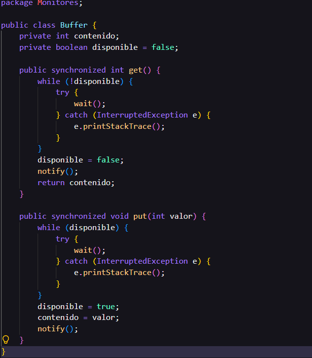
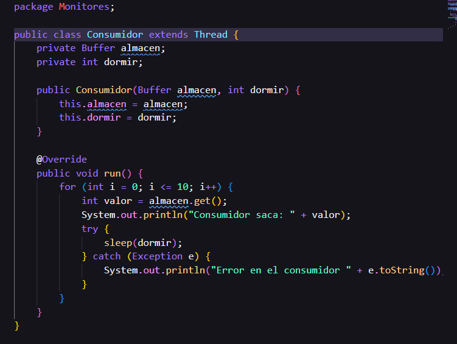
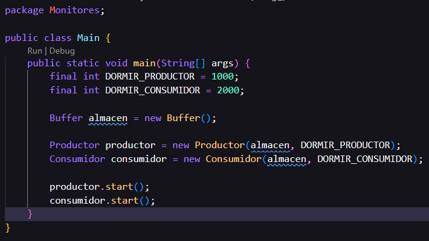
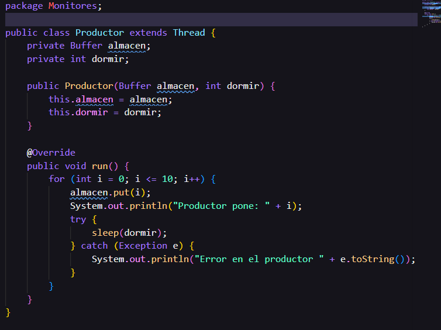
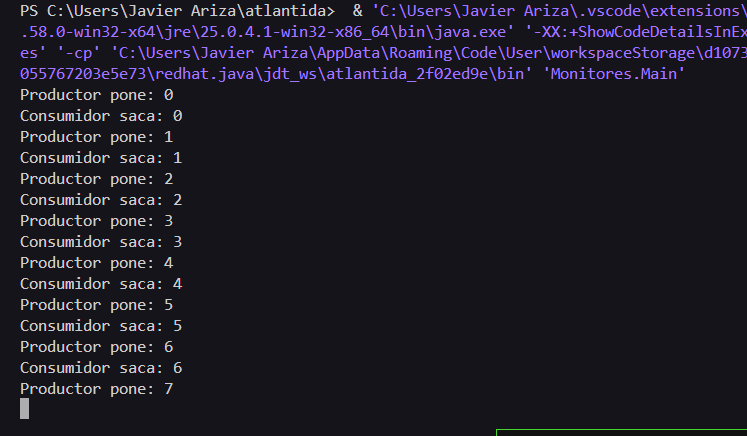
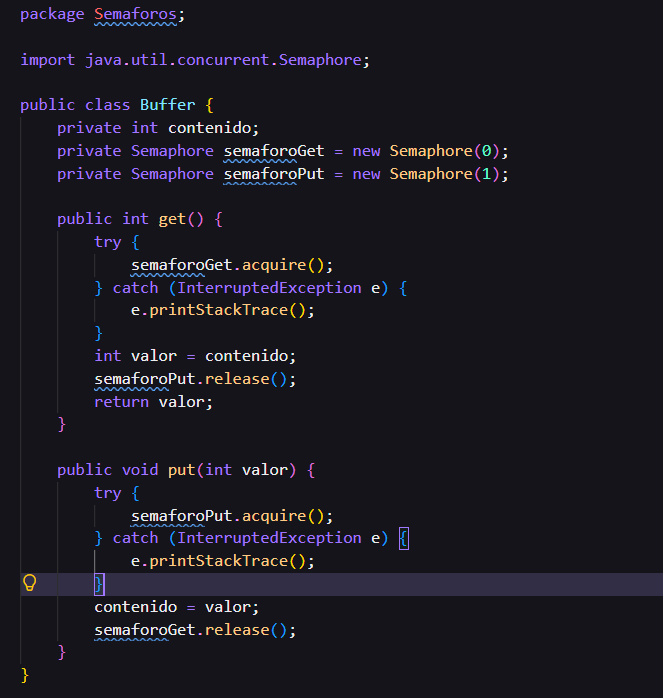
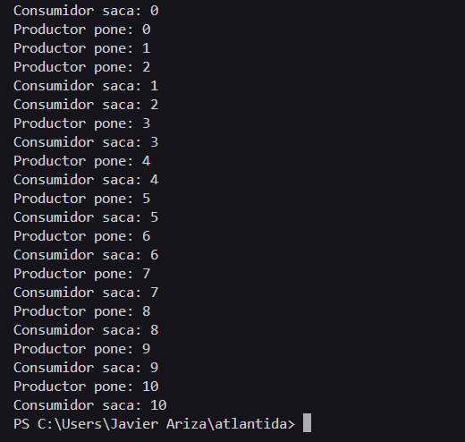

# Ejercicio 1

**Codigo en ejecucion**

# Ejercicio 2

**Codigo en ejecucion**

En este enlace esta el repositorio con el código: [Enlace repo](https://github.com/Jarizapulido/SSPP/tree/main/Practica6)